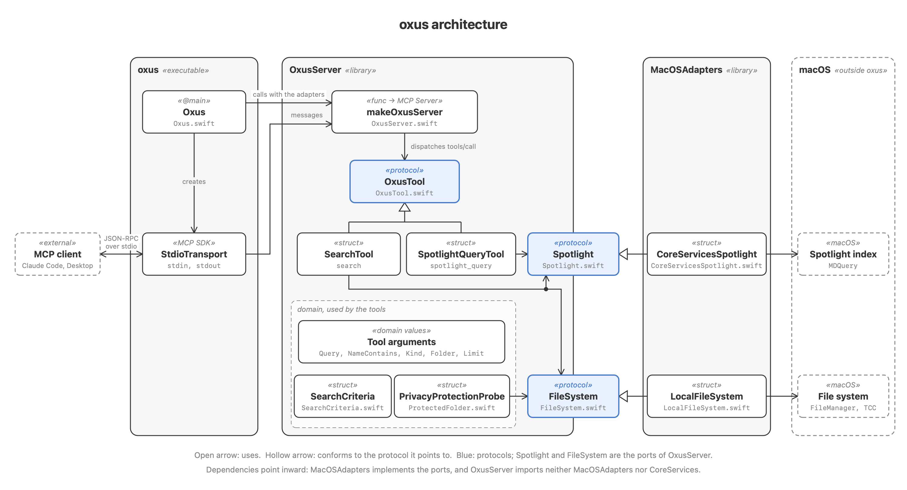

# Architecture

oxus follows ports and adapters: the behaviour lives in `OxusServer`, which reaches macOS only through two protocols, its ports, that `MacOSAdapters` implements.



## Three modules

| Module | Kind | Role | Imports |
|---|---|---|---|
| `oxus` | executable | Composition root: wires the adapters into the server and connects it to stdio | `OxusServer`, `MacOSAdapters`, `MCP` |
| `OxusServer` | library | The tools, their domain values, and the `Spotlight` and `FileSystem` ports | `MCP` |
| `MacOSAdapters` | library | `CoreServicesSpotlight` on `MDQuery`, `LocalFileSystem` on `FileManager` | `OxusServer`, CoreServices |

Dependencies point inward. `MacOSAdapters` depends on `OxusServer` to implement its ports, never the other way round, and it never imports `MCP`. `OxusServer` never imports CoreServices, so its tests swap the adapters for test doubles and drive the server through an in-memory MCP client.

## A tool call

1. The MCP client sends a JSON-RPC request on stdin; `StdioTransport` hands it to the `Server` that `makeOxusServer` built.
2. The server dispatches `tools/call` by name to an `OxusTool`: `SpotlightQueryTool` or `SearchTool`. An unknown name is a protocol error.
3. The tool reads its arguments once into domain values (see [Tool arguments](tool-arguments.md)). `SearchTool` turns them into `SearchCriteria`, which builds the Spotlight query, and checks a `folder` through `FileSystem`.
4. `PrivacyProtectionProbe` checks, through `FileSystem`, which of Downloads, Documents and Desktop macOS privacy protection denies, since Spotlight silently leaves out their files.
5. The tool runs the query through `Spotlight` and returns `paths`, `truncated` and any `unreadableFolders` as the result. `truncated` says whether `limit` cut the result off. A failure of a known tool returns a result with `isError: true`.

`oxus --version` never reaches the server: `Oxus` prints the version and exits before creating the transport.

## Regenerating the diagram

The diagram is drawn by a script; change it with the modules and run it from the repository root:

```sh
swift docs/design/architecture.swift docs/design/architecture.png
```
