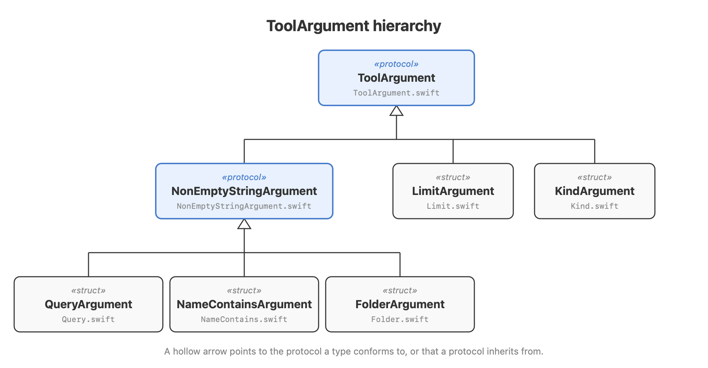

# Tool arguments

A tool call's arguments arrive as untyped MCP `Value`s. Each argument is read once, at the edge of `OxusServer`, into a domain value the rest of the server trusts.



## Two types per argument

Each argument has a domain type and an argument type, side by side in one file:

| Argument | Domain type | Argument type | File |
|---|---|---|---|
| `query` | `Query` | `QueryArgument` | `Query.swift` |
| `name_contains` | `NameContains` | `NameContainsArgument` | `NameContains.swift` |
| `folder` | `Folder` | `FolderArgument` | `Folder.swift` |
| `kind` | `Kind` | `KindArgument` | `Kind.swift` |
| `limit` | `Limit` | `LimitArgument` | `Limit.swift` |

- The **domain type** holds the rule that makes a value valid, such as a limit between 1 and 100 or a folder with an absolute path. `Spotlight` and the tools take domain types only.
- The **argument type** is the boundary: it knows the argument's MCP name, its JSON schema, and how to read it from a `Value`. A value it cannot read becomes a `ToolFailure`, whose message the client receives as an error result.

Keeping the two apart means the `Spotlight` port and its adapters never see MCP, and a domain rule is written once, whichever tool uses it.

## The protocols

- **`ToolArgument`** is what every argument type conforms to: a `name`, a `schema`, and an `init` from a `Value`. A tool's arguments dictionary reads one with `required(_:)`, which fails with `MissingArgument` when the client left it out, or `optional(_:)`, which returns `nil`.
- **`NonEmptyStringArgument`** refines it for arguments that must be a string that is not blank: `query`, `name_contains` and `folder`. It rejects anything else with the same message for all three.

## Regenerating the diagram

The diagram is drawn by a script; change it with the types and run it from the repository root:

```sh
swift docs/design/tool-argument-hierarchy.swift docs/design/tool-argument-hierarchy.png
```
